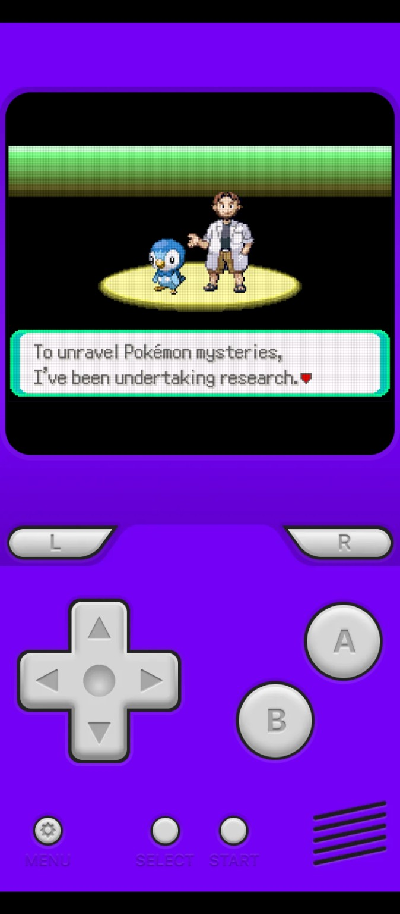
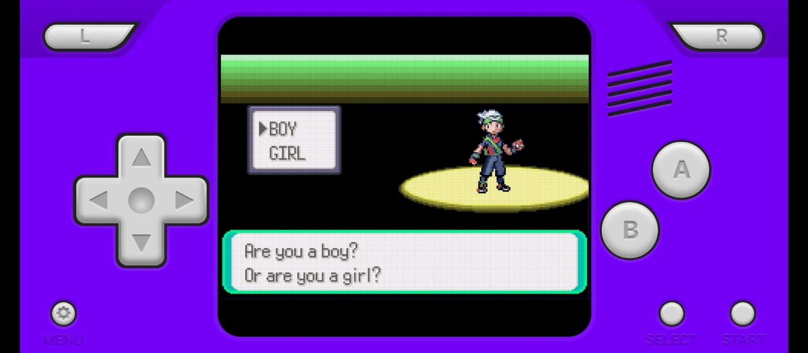
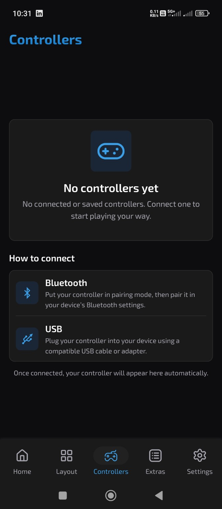
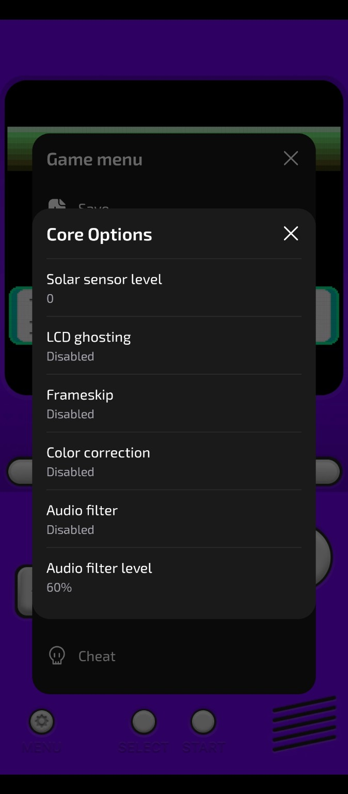
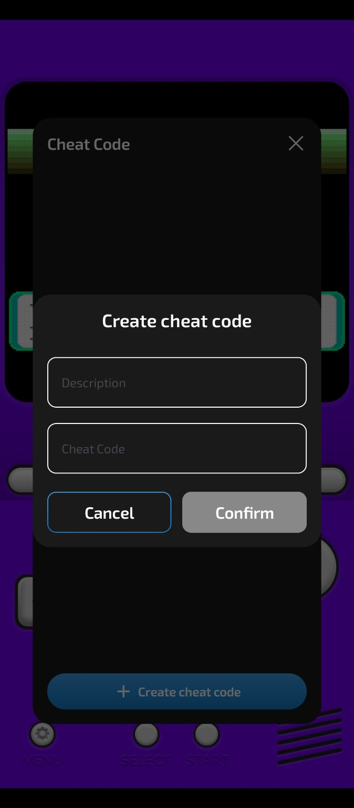
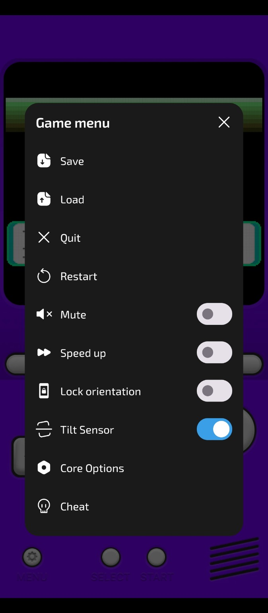
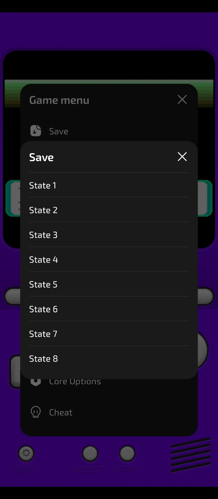
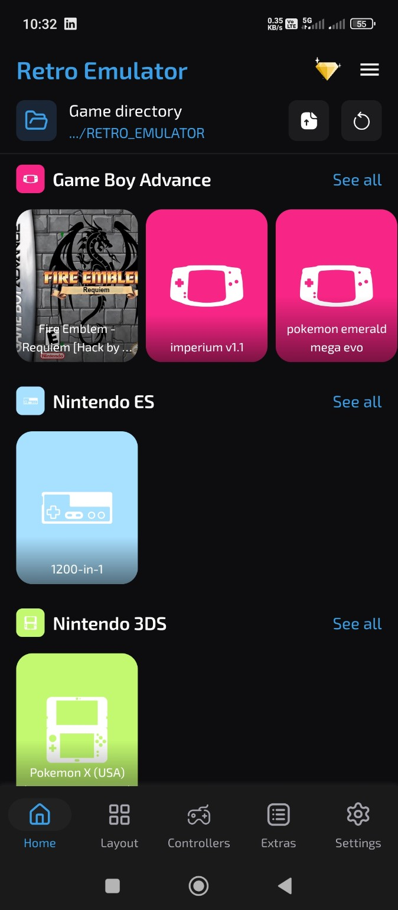

# Reference screenshots

These eight images were supplied for this project on 16 November 2026. They are stored here as implementation references; they are not production assets and should not be copied as app branding.

| File | Screenshot | What it informs |
|---|---|---|
| [01-gameplay-portrait.jpg](01-gameplay-portrait.jpg) |  | Portrait handheld shell, display bezel, L/R, D-pad, A/B, Start/Select/Menu. The Pokémon professor dialogue is game content rendered by the emulator. |
| [02-gameplay-landscape.jpg](02-gameplay-landscape.jpg) |  | Landscape layout: centred game viewport, D-pad on left, action buttons on right, shoulder buttons at the outer top corners. |
| [03-controllers-screen.jpg](03-controllers-screen.jpg) |  | Controllers tab, empty state, Bluetooth/USB connection guidance, automatically detected devices. |
| [04-core-options-dialog.jpg](04-core-options-dialog.jpg) |  | Core-options modal and value rows such as frameskip, colour correction, and audio filters. Render actual options from the core dynamically. |
| [05-cheat-code-dialog.jpg](05-cheat-code-dialog.jpg) |  | Add-cheat flow with description/code fields and Cancel/Confirm actions. |
| [06-game-menu.jpg](06-game-menu.jpg) |  | In-game menu actions: save/load, quit, restart, mute, speed-up, orientation lock, core options, cheats. |
| [07-save-state-slots.jpg](07-save-state-slots.jpg) |  | Numbered save-state slot picker (eight visible slots). |
| [08-library-home.jpg](08-library-home.jpg) |  | Home library with selected game directory, system sections, game cards, and five-tab bottom navigation. Only GBA/GB/GBC sections are in v1 scope. |

## How to use these references

- Treat the images as visual guidance for layout, hierarchy, and feature expectations.
- The first two screenshots show a game running; they are not app onboarding or app-owned Pokémon content.
- The library screenshot includes NES and 3DS examples. Those systems are excluded from this GBA/GB/GBC app's first release.
- Do not bundle any commercial ROM, game screenshot, franchise logo, or BIOS file because it appears in a reference.
- The app can use an original handheld-inspired visual language while keeping the supplied purple colour direction.
